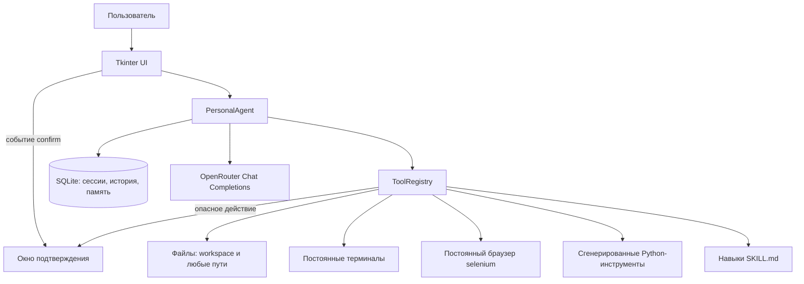

# Архитектура

## Слои

- `ui/app.py` — главное окно: боковая панель сессий, лента сообщений, ввод, подтверждения. Агент работает в фоновом потоке и общается с UI через очередь событий.
- В ленте чата контекстное меню пользовательского сообщения возвращает историю к этому запросу и загружает его в поле ввода для редактирования; меню ответа запускает повторную генерацию с исходного запроса. Уже выполненные действия инструментов при регенерации не отменяются.
- `ui/widgets.py` — карточки сообщений, сворачиваемые карточки инструментов, кнопки, диалоги (подтверждение, память, инструменты).
- `ui/hotkeys.py` — Ctrl+C/V/X/A/Z/Y и контекстное меню, не зависящие от раскладки. `ui/markdown.py`, `ui/theme.py`, `ui/settings.py` — разбор Markdown, темы, настройки интерфейса.
- `core/agent.py` — системный промпт и цикл «модель → инструмент → модель» с остановкой, лимитом шагов и откатом на режим без инструментов.
- `core/tools.py` — реестр инструментов и **шлюз подтверждений**; генерируемые инструменты; резервные копии в `data/backups`.
- `core/terminals.py`, `core/browser.py` — настоящие постоянные терминалы и сессия браузера (состояние живёт между вызовами).
- `core/memory.py` — SQLite с ID сообщений, обновлением пользовательского запроса и удалением последующей ветки истории. В запросы к модели попадают только корректные цепочки user/assistant/tool (без «осиротевших» tool-сообщений).
- `core/openrouter.py` — HTTP-клиент с повторами при 429/5xx.

## Границы доверия

Это **не** песочница. Модель, веб-страницы, навыки и сгенерированный код работают с правами пользователя. Защита построена на трёх вещах:

1. Шлюз подтверждений: удаление, запись вне `workspace/`, выполнение команд, создание и первый запуск сгенерированных инструментов, ввод текста в браузере (можно отключить переключателем «Подтверждать действия»).
2. Системный промпт требует считать содержимое файлов, страниц и результатов инструментов данными, а не командами. Это смягчает prompt injection, но не гарантирует защиту.
3. Резервные копии перезаписываемых файлов в `data/backups/`.

Любой код, который агент создаст и запустит после вашего подтверждения, выполняется без ограничений.
